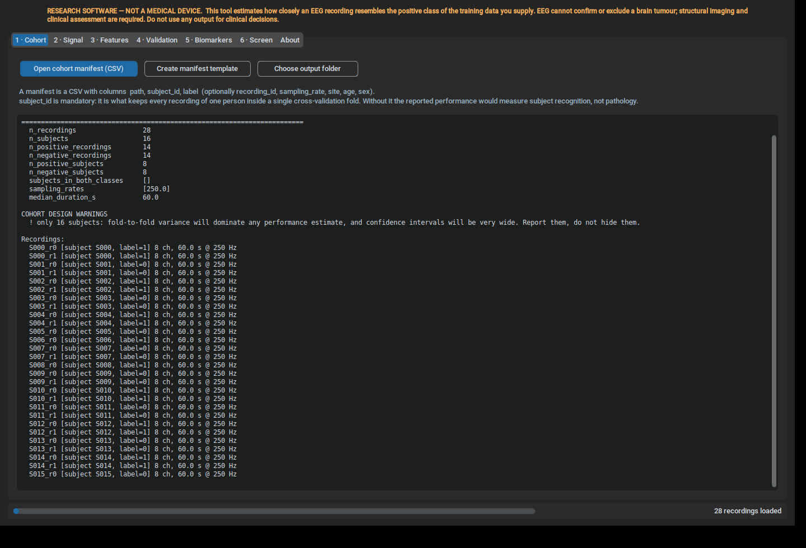
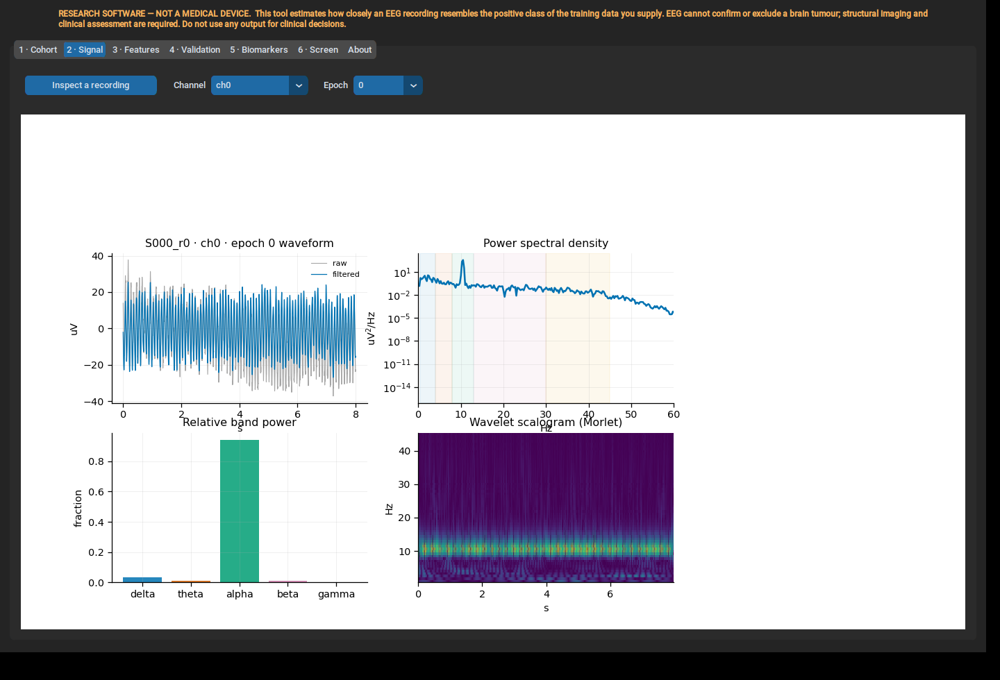
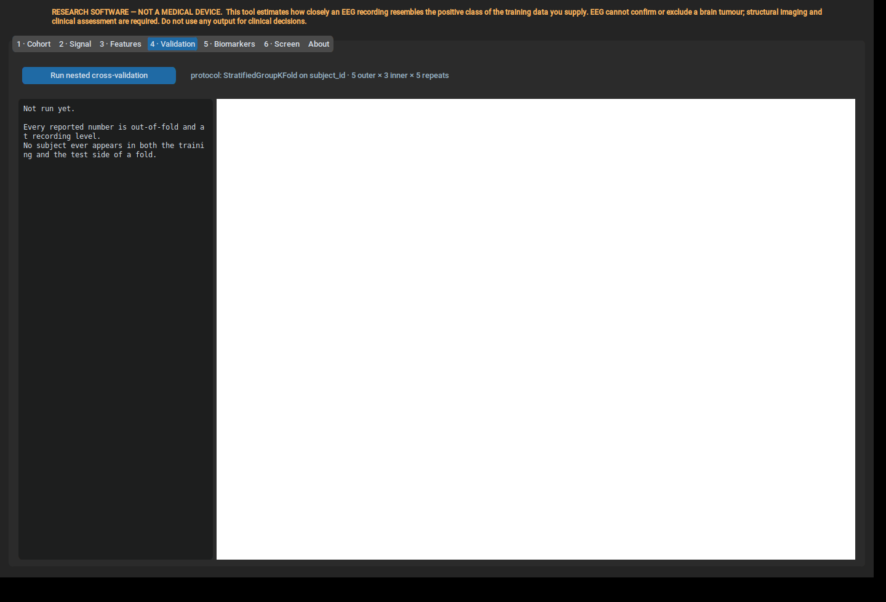
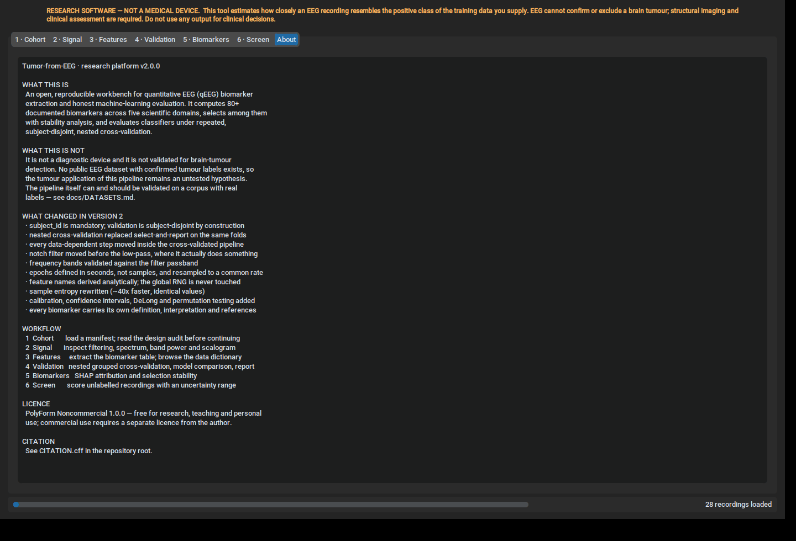
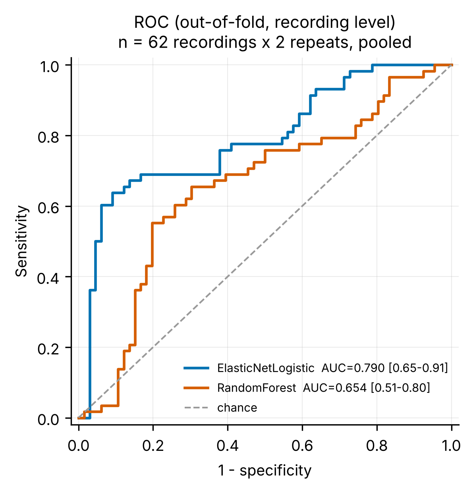
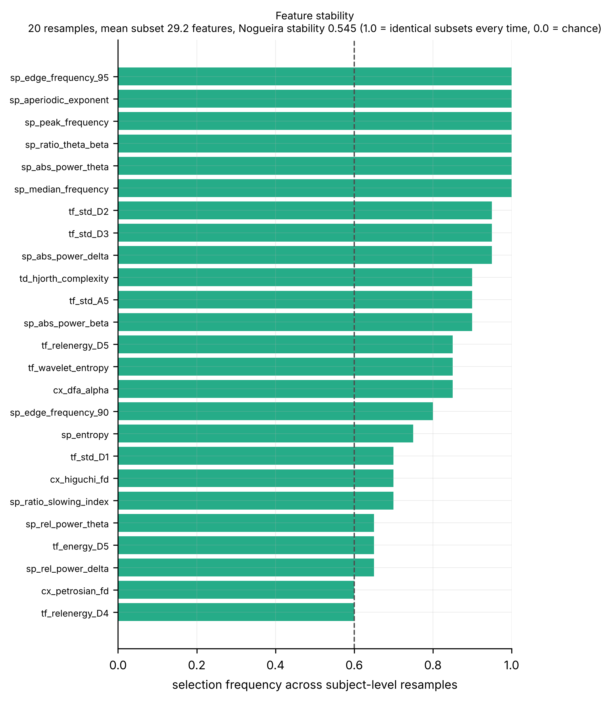
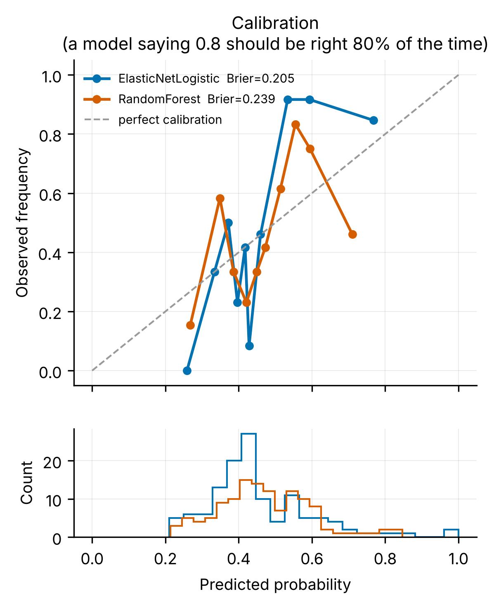
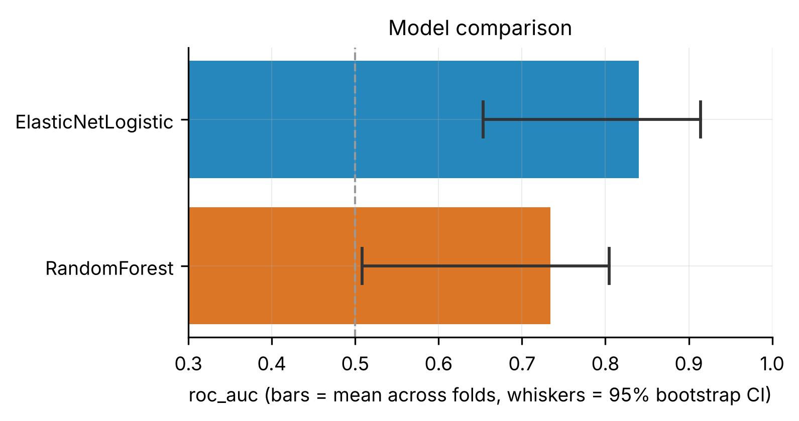

# Tumor-from-EEG

A reproducible workbench for quantitative EEG biomarker extraction and
subject-disjoint machine-learning evaluation.

[](https://doi.org/10.5281/zenodo.21762150)
[](https://github.com/soheilkooklan/Tumor-from-EEG/actions/workflows/tests.yml)


> **Research software, not a medical device.** This tool cannot diagnose a
> brain tumour and must not inform any clinical decision. Parts of the code,
> the user interface and the documentation were developed with AI assistance.
> Read [DISCLAIMER.md](DISCLAIMER.md) before anything else.

## What this is

Version 1 was a GUI around a wavelet-and-ANN script. It ran without errors for
a long time while its numbers measured nothing. Version 2 is a rewrite that
started from one controlled experiment: a synthetic cohort of 40 subjects with
19 channels each, where the class label of every subject was drawn at random.
An honest protocol should return ROC-AUC near 0.5 on that data.

| Protocol | ROC-AUC on label-free data |
|---|---|
| v1: global scaler and channel-level `StratifiedKFold` | 0.957 ± 0.010 |
| v2: subject-disjoint `StratifiedGroupKFold` and fold-internal pipeline | 0.398 ± 0.230 |

Version 1 was recognising which person a channel came from, because channels
from one subject sat on both sides of the split. This is the record-wise versus
subject-wise error described by Saeb et al. (2017). Kapoor and Narayanan (2023)
list it among the leakage types they found across machine-learning-based
science.

The software computes 81 documented qEEG biomarkers in five domains, selects
among them inside each training fold, and evaluates classifiers with repeated,
subject-disjoint, nested cross-validation, calibration, subject-level bootstrap
intervals and an optional subject-level permutation null.

It does not tell you that someone has a brain tumour. There is no public EEG
dataset with imaging-confirmed tumour labels, so that application is an
untested hypothesis. See [docs/LIMITATIONS.md](docs/LIMITATIONS.md).

## Screenshots

| Cohort: load, audit, inspect | Signal: filtering, spectrum, scalogram |
|---|---|
|  |  |

| Validation: nested grouped CV | About: scope and limits |
|---|---|
|  |  |

The screenshots are captured from the running application by
`tools/capture_screenshots.py`.

## Install

```bash
git clone https://github.com/soheilkooklan/Tumor-from-EEG.git
cd Tumor-from-EEG
pip install -r requirements.txt
pytest -q                     # 40 tests, all should pass
```

Python 3.10 or newer. Only the core block of `requirements.txt` is needed to
run an analysis. XGBoost, LightGBM, SHAP, MNE, Optuna and CustomTkinter are
optional, and the software prints a message and carries on when one is absent.

## Quick start

No clinical data ships with this repository. Generate a synthetic cohort with a
known effect, audit it, then run it:

```bash
python examples/make_demo_cohort.py --out demo_data --effect 0.7 --subjects 40
python -m eegtumor.cli audit --manifest demo_data/cohort.csv
python -m eegtumor.cli run --manifest demo_data/cohort.csv \
       --config configs/quick.yaml --models ElasticNetLogistic RandomForest \
       --permutations 50 --out results/
```

`configs/quick.yaml` uses two repeats and ten tuning trials so a first run
finishes in reasonable time. Use `configs/default.yaml` for anything you intend
to report.

Then run the negative control, which matters more:

```bash
python examples/make_demo_cohort.py --out demo_null --effect 0.0 --subjects 40
python -m eegtumor.cli run --manifest demo_null/cohort.csv \
       --config configs/quick.yaml --out results_null/
```

With `--effect 0.0` the labels carry no information. A correct pipeline returns
ROC-AUC near 0.5. If it returns 0.9, something is leaking, and no other result
from that installation should be trusted.

`--permutations N` repeats the outer cross-validation N times with labels
shuffled between subjects and reports where the observed score sits in that
null. Each permutation is a full cross-validation run, so tuning is switched
off inside it, for the observed score as well as the permuted ones.

Graphical interface:

```bash
python main.py
```

## Your own data

A cohort is a CSV manifest. `subject_id` is mandatory: it keeps every recording
of one person inside a single cross-validation fold.

```csv
path,subject_id,label,recording_id,sampling_rate,site,age,sex
recordings/p01_a.edf,P01,0,,,siteA,54,F
recordings/p01_b.edf,P01,0,,,siteA,54,F
recordings/p02_a.edf,P02,1,,,siteA,61,M
data/control_07.csv,C07,0,,250,siteB,49,F
```

Supported formats are EDF, BDF, CSV, TSV, MAT, NPY and NPZ. The sampling rate is
read from EDF and BDF headers and must be given in the manifest for the other
formats. It cannot be inferred, and a wrong value invalidates every spectral
feature without any error.

Always audit first:

```bash
python -m eegtumor.cli audit --manifest cohort.csv
```

The audit flags design confounds that correct cross-validation cannot fix:
classes recorded at different sampling rates, class-correlated recording
lengths, subjects in both classes, mismatched montages and too few subjects.

## Method summary

Full detail is in [docs/METHODS.md](docs/METHODS.md).

Preprocessing. Resampling to a common rate, DC removal, a mains notch applied
before the low-pass, a zero-phase second-order-section band-pass (0.5 to 45 Hz
by default), common average reference, epoching in seconds, and per-epoch
quality control with recorded reasons. Frequency bands are checked against the
passband when the configuration is built, so asking for 30 to 45 Hz gamma
through a 1 to 30 Hz filter raises an error.

Features. 81 biomarkers, each with its definition, physiological
interpretation, references, complexity and amplitude dependence, exported as
`feature_dictionary.csv` with every run.

| Domain | n | Contents |
|---|---|---|
| Time | 17 | moments, RMS, line length, Hjorth, Teager energy |
| Spectral | 27 | multitaper PSD, band power and ratios, spectral edge, aperiodic 1/f exponent |
| Time-frequency | 26 | DWT sub-band energy, SD, kurtosis, wavelet entropy |
| Entropy | 5 | sample (k-d tree), permutation, Shannon, multiscale |
| Complexity | 6 | Higuchi, Katz and Petrosian FD, DFA, Hurst, Lempel-Ziv |

The features are not equally well supported. Focal slowing is the classical
scalp correlate of a structural lesion, so the band ratios, in particular
`sp_ratio_slowing_index` = (delta + theta) / (alpha + beta), have clinical
literature behind them. The entropy and complexity families are exploratory and
documented as such.

Selection. A staged funnel (variance, correlation, mutual information, embedded
importance, cap) written as a scikit-learn transformer, so it is refitted inside
every training fold. Selection frequency across subject-level resamples is
reported with the Nogueira stability index.

Validation. Hyper-parameters are tuned with Optuna in an inner subject-disjoint
loop, and performance is read from outer folds the tuning never saw, repeated
across seeds. Calibration uses subject-disjoint folds inside each training
fold. Epoch scores are aggregated to recordings before any metric. Intervals
come from a percentile bootstrap over subjects. DeLong and McNemar tests compare
models. The model family shown in the confusion matrix and SHAP figures is the
one with the best outer-fold ROC-AUC, which makes its score optimistic by that
choice; the report says so, and `--models` lets you fix one family in advance.

Explainability. Exact SHAP where the model allows it (`TreeExplainer` for
forests, `LinearExplainer` for linear models), and the model-agnostic explainer
only otherwise. SHAP describes the model, not the biology.

## Example output

Every run writes a timestamped directory named after the configuration
fingerprint. It contains the configuration actually used, the environment, the
feature table, the feature dictionary, metrics, model comparisons, stability,
the permutation null when requested, figures in PNG and PDF, and a
self-contained HTML report.

| ROC (out-of-fold, recording level) | Selection stability |
|---|---|
|  |  |

| Calibration | Model comparison |
|---|---|
|  |  |

These figures come from the synthetic demo cohort (40 subjects, 62 recordings,
`configs/quick.yaml`), not from clinical data. On a cohort this size a 95 %
interval on ROC-AUC is often 0.25 wide or more, and that width is part of the
result.

A published analysis should be reproducible from the manifest and the emitted
configuration:

```bash
python -m eegtumor.cli run --manifest cohort.csv \
       --config results/run_.../config_used.yaml --out reproduction/
```

## Repository layout

```
eegtumor/
  config.py          analysis configuration and consistency checks
  io.py              readers (EDF/BDF/CSV/MAT/NPY), Cohort, design audit
  preprocessing.py   filtering, resampling, epoching, quality control
  features/          registry and five biomarker domains
  selection.py       staged selection funnel and stability analysis
  modeling.py        model zoo, leakage-safe pipeline, calibration, aggregation
  validation.py      nested grouped CV, metrics, bootstrap, DeLong, McNemar,
                     permutation null
  explain.py         SHAP and grouped permutation importance
  reporting.py       figures and HTML report
  experiment.py      one complete run, shared by the CLI and the GUI
  cli.py             command-line entry point
  gui.py             seven-tab graphical interface
configs/             default.yaml and quick.yaml
tests/               40 tests: estimator correctness and leakage regression
docs/                METHODS, DATASETS, LIMITATIONS, MIGRATION
examples/            synthetic cohort generator, including the null control
tools/               screenshot capture
legacy/              version 1, preserved
```

## Adding a biomarker

Feature families register themselves. A new one is one module and one
`register_group` call, with no change to existing files:

```python
# eegtumor/features/my_domain.py
from . import FeatureGroup, FeatureSpec, register_group

def names(fcfg, bands):  return ["my_feature"]
def docs(fcfg, bands):   return {"my_feature": FeatureSpec(
    name="my_feature", domain="spectral",
    description="...", interpretation="...",
    references=("Author et al. 2024",), complexity="O(n)")}
def compute(x, fs, fcfg, bands):
    from collections import OrderedDict
    return OrderedDict([("my_feature", float(...))])

register_group(FeatureGroup("my_group", "spectral", names, compute, docs))
```

A group declares its output names before it sees any data, which keeps the
feature matrix the same width for every window length.

## Datasets

The pipeline itself can be validated on a corpus with real labels and
subject-disjoint splits. The TUH Abnormal EEG Corpus is the obvious choice.
Published accuracy on its evaluation split for the normal-versus-abnormal task
mostly falls between about 75 and 90 %, with a few recent reports a little above
90 % (Zhu, Canham and Western, 2023), on far more data than a typical tumour
study. Keep that in mind when reading a
claim of 95 % tumour detection from a few dozen recordings. See
[docs/DATASETS.md](docs/DATASETS.md).

## Contributing

Issues and pull requests are welcome, in particular for connectivity features,
montage harmonisation, more readers and validation runs on public corpora. Two
rules: `pytest -q` must pass, and any change to preprocessing, selection,
calibration or validation must keep `tests/test_leakage.py` green. That file
exists so the version 1 defect cannot come back.

## Licence

PolyForm Noncommercial 1.0.0: free for research, teaching, personal study and
use by charitable, educational, public research, health and government
organisations. Commercial use needs a separate licence from the author. A
noncommercial licence is not OSI-approved open source.

Version 1 was released under the MIT licence and stays MIT; that grant cannot be
withdrawn for the code it covered. See [CHANGELOG.md](CHANGELOG.md) and
`LICENSE-v1-MIT.txt`.

## Citation

Archived release: [doi.org/10.5281/zenodo.21762150](https://doi.org/10.5281/zenodo.21762150).
Citation metadata is in [CITATION.cff](CITATION.cff). In text:

> Kooklan, S. (2026). *Tumor-from-EEG: a reproducible workbench for quantitative
> EEG biomarker extraction and subject-disjoint machine-learning evaluation*
> (Version 2.1.0) [Computer software].
> https://github.com/soheilkooklan/Tumor-from-EEG

## References

Saeb et al. (2017) *GigaScience* 6(5); Kapoor and Narayanan (2023) *Patterns*
4(9); Ambroise and McLachlan (2002) *PNAS* 99(10); Nogueira et al. (2018)
*JMLR* 18; Donoghue et al. (2020) *Nat Neurosci* 23; Thomson (1982) *Proc IEEE*
70(9); Richman and Moorman (2000) *Am J Physiol* 278; Higuchi (1988) *Physica D*
31; Hjorth (1970) *Electroencephalogr Clin Neurophysiol* 29; Gloor et al. (1977)
*Neurology* 27(4); Finnigan and van Putten (2013) *Clin Neurophysiol* 124(1).
The full list is in [docs/METHODS.md](docs/METHODS.md).
