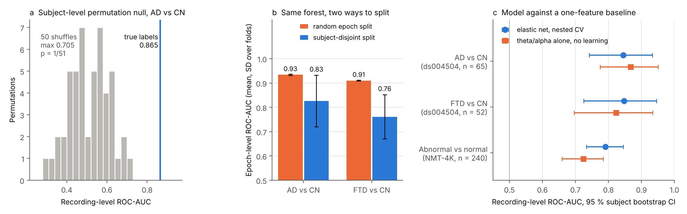

# Results on real recordings

Version 2.2.0 is the first version run end to end on real EEG. There is still
no public tumour cohort (see [DATASETS.md](DATASETS.md)), so the tests below use
two public corpora with confirmed labels for other conditions. They check that
the pipeline behaves as designed on clinical recordings. They say nothing about
tumours.

All numbers come from `configs/quick.yaml` (5 outer and 3 inner folds, 2
repeats, 10 Optuna trials) on a 2-core machine with 7 GB of memory. The default
configuration uses 5 repeats and 40 trials, so the intervals below are a little
wider than a default run would give. Every split is subject-disjoint, and every
AUC is computed per recording after trimmed-mean aggregation of epoch scores.



(a) Subject-level permutation null for AD vs CN. (b) The same random forest
under a random epoch split and a subject-disjoint split. (c) The nested
elastic net next to the theta/alpha ratio used on its own.

## Data

**OpenNeuro ds004504** (Miltiadous et al., 2023, CC0). Eyes-closed resting EEG
from 88 people: 36 with Alzheimer's disease (AD), 23 with frontotemporal
dementia (FTD) and 29 cognitively normal controls (CN). 19 channels, 500 Hz,
one recording per person. With 60 epochs of 8 s per recording this gives
99,325 epoch-channel rows and 81 features. Two tasks were run: AD vs CN (65
subjects) and FTD vs CN (52 subjects).

**NMT-4K-EEG v1.1** (Masood et al., NUST, 2026, CC BY 4.0). 4,500 clinical
recordings labelled normal or abnormal. A balanced subset of 240 was used: 60
in each cell of label x recording year (2019, 2024), all from one hospital
code, 200 Hz, 22 channels (19 scalp plus ECG, A1, A2), 20 epochs each. The
archive has no patient identifier, so each recording is treated as its own
subject.

`examples/openneuro_ds004504.py` and `examples/nmt4k_subset.py` download both
and write the manifests.

## Alzheimer's and frontotemporal dementia

| | AD vs CN | FTD vs CN |
|---|---|---|
| Subjects (positive) | 65 (36) | 52 (23) |
| Elastic net, mean fold AUC (SD) | 0.877 (0.105) | 0.881 (0.131) |
| Elastic net, pooled AUC [95% CI] | 0.845 [0.742, 0.933] | 0.847 [0.725, 0.946] |
| Random forest, untuned, pooled AUC [95% CI] | 0.847 [0.742, 0.934] | 0.841 [0.716, 0.947] |
| Balanced accuracy | 0.794 | 0.716 |
| Brier score | 0.151 | 0.181 |
| Sensitivity at 90% specificity | 0.708 | 0.500 |
| Median theta/alpha ratio alone, no learning | 0.867 | 0.823 |
| Age alone | 0.436 | 0.352 |

The confidence intervals are subject-level bootstrap intervals (2,000
resamples). For AD vs CN on the same corpus, Mlinarič et al. (2026) report a
leave-one-subject-out AUC of 0.818 for a stacked connectivity ensemble and
0.887 for their best single classifier. Both lie inside our interval.

Balanced accuracy, Brier score and sensitivity are for the elastic net. The
untuned random forest (100 trees, default settings) landed within 0.01 of it
on both tasks.

The single theta/alpha ratio, taken as a per-subject median with no training at
all, does as well as either trained model on both tasks. On this corpus the
signal is EEG slowing, and one feature already carries most of it. A learned
model that cannot beat a one-line baseline should be reported that way, so
from 2.2.0 every run computes this baseline (`validation.baseline_feature`,
default `sp_ratio_theta_alpha`) and prints it in the report next to the
models.

FTD patients in ds004504 are younger than the controls (age alone gives 0.352,
or 0.648 if the sign is flipped). That is a mild confound to keep in mind for
the FTD result. Age carries almost no information for AD vs CN.

### Record-wise vs subject-wise splitting

The same random forest (100 trees, depth at most 12), the same features and
the same scaler fitted on all rows, evaluated two ways:

| Split | AD vs CN, epoch AUC | FTD vs CN, epoch AUC |
|---|---|---|
| Random epoch split (StratifiedKFold) | 0.934 (0.003) | 0.910 (0.002) |
| Subject-disjoint split (StratifiedGroupKFold) | 0.826 (0.106) | 0.761 (0.091) |

The row split puts epochs of one person in both training and test folds, so
part of what the model learns is the person. The gap is 0.11 for AD and 0.15
for FTD, and the row split also hides the fold-to-fold spread: its SD is 30 to
45 times smaller.

### Permutation null

Labels were shuffled between subjects, never between epochs of one subject,
and the full subject-disjoint cross-validation was rerun 50 times (two
batches of 25 with different seeds). The elastic net scored 0.865 on the true
labels in this setting (fixed hyperparameters, no calibration). The 50 null
runs had mean 0.511, SD 0.098 and maximum 0.705. None reached the observed
value, so p = 1/51 = 0.020, which is the smallest p-value 50 permutations can
give.

### Feature selection stability

Selection was repeated on 20 subject-level resamples. The Nogueira stability
index was 0.71 for AD vs CN and 0.62 for FTD vs CN. The features chosen in
every resample for AD were the classical slowing markers: theta/alpha and
theta/beta ratios, relative alpha and theta power, peak frequency, spectral
entropy, and the standard deviation and kurtosis of the D4 and D5 wavelet
coefficients. For FTD the list
was similar, with Petrosian and Higuchi fractal dimension and median frequency
added.

## NMT-4K: normal vs abnormal, and the recording year

| Test | Recordings | Pooled AUC [95% CI] |
|---|---|---|
| Normal vs abnormal, all | 240 | 0.791 [0.733, 0.845] |
| Normal vs abnormal, 2019 only | 120 | 0.771 [0.683, 0.852] |
| Normal vs abnormal, 2024 only | 120 | 0.796 [0.711, 0.874] |
| 2019 vs 2024, normal recordings only | 120 | 0.702 [0.611, 0.789] |
| 2019 vs 2024, abnormal recordings only | 120 | 0.524 [0.442, 0.606] |
| Median theta/alpha alone, normal vs abnormal | 240 | 0.724 [0.659, 0.784] |

Abnormality detection holds within each year, so the model is not reading the
year to find abnormal EEG. Here the model does beat the theta/alpha baseline,
by about 0.07; abnormal clinical EEG is a wider category than slowing. The year itself, however, can be predicted from
normal recordings at 0.70. The headers are identical across years (same
sampling rate, same 22 channels, same units, same empty prefilter field), and
mean age is 25 to 26 years in every cell, so the difference sits in the signal.
Age is missing for about half of the 2024 recordings, which is one more
thing that differs by year.
A change of amplifier or recording protocol between 2019 and 2024 is the
likely cause; the dataset documentation does not say.

To see what that does to a careless design, the model was trained on a fully
confounded set (all abnormal recordings from 2019, all normal ones from 2024)
and tested on the reverse pairing. Its AUC on its own training data was 0.868.
On the reverse pairing it fell to 0.751. A study that collected patients in
one period and controls in another would have reported the first number.

The full NMT-4K corpus also has recording year strongly tied to label: the
share of abnormal recordings differs by year, split and hospital code. The
balanced subset exists to break that link. Anyone using the full corpus should
stratify by year and hospital, or at least report results within each.

## Problems the real data exposed

Running on these recordings found six faults that the synthetic tests had not.
All are fixed in 2.2.0 and listed in [CHANGELOG.md](../CHANGELOG.md): no EEGLAB
reader; the whole cohort loaded into memory; ECG and ear electrodes entering
the average reference; the stability report selecting on unscaled features
while the model selected on scaled ones; the elastic-net C range clipped at its
lower bound in 6 of 10 folds; and feature extraction and nested CV too slow to
run on a laptop.

## Reproducing

```bash
python examples/openneuro_ds004504.py --out data/ds004504
python -m eegtumor.cli run --manifest data/ds004504/cohort_ad_vs_cn.csv \
       --config configs/quick.yaml --jobs 2 --permutations 50 --out results/ad_vs_cn

python examples/nmt4k_subset.py --out data/nmt
python -m eegtumor.cli run --manifest data/nmt/manifest240.csv \
       --config configs/quick.yaml --jobs 2 --out results/nmt
```

On two cores, feature extraction takes about an hour per corpus and a nested
run about an hour per task. A 50-permutation null takes about three hours.

## References

Masood H., Shafait F., Bajwa M. N., Malik M. I., Shafait S., Khan H. A. (2026).
NMT-4K-EEG: A curated clinical EEG dataset for normal and abnormal EEG
detection, v1.1. Zenodo. doi:10.5281/zenodo.21041582

Miltiadous A. et al. (2023). A dataset of scalp EEG recordings of Alzheimer's
disease, frontotemporal dementia and healthy subjects from routine EEG. Data
8(6), 95. doi:10.3390/data8060095

Mlinarič T., Van Den Kerchove A., Barinaga Z. I., Van Hulle M. M. (2026).
EEG-based classification of Alzheimer's disease and frontotemporal dementia
using functional connectivity. Scientific Reports 16, 4903.
doi:10.1038/s41598-026-35316-9
